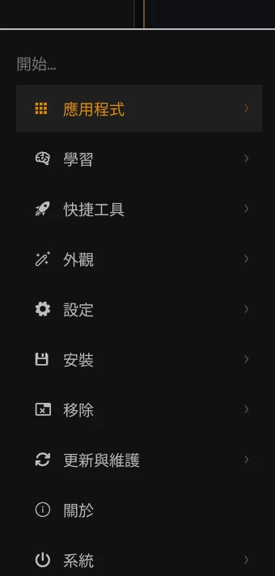
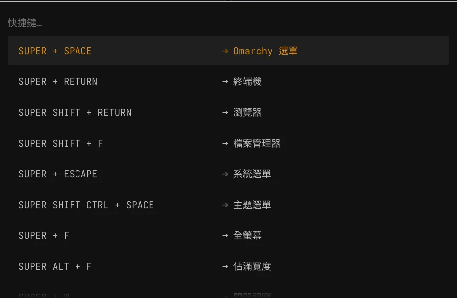
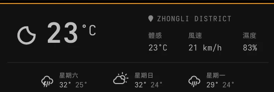
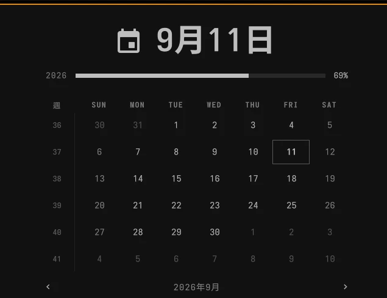
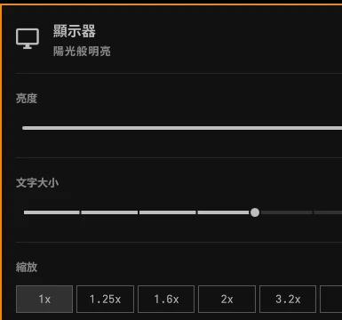

# Omarchy 台灣用語（zh-TW）

**繁體中文** | [English](README.en.md)

Omarchy 4.5 起內建繁體中文翻譯。這個非官方專案把 Omarchy 的介面語言切到 zh-TW，再在官方翻譯上疊加一層**台灣用語覆蓋**：修正與[詞彙表](docs/glossary.md)衝突的用語，並補上官方還沒翻譯的字串。

- 不修改 `/usr/share/omarchy`，也不在儲存庫中散布 Omarchy 的原始碼。
- 只覆蓋需要改的字串，其餘全部沿用官方翻譯，跟著 Omarchy 更新。
- Omarchy 更新後自動重新同步；上游結構不相容時明確失敗，並保留上一份可用版本。

本專案衍生自 [QueedWen/omarchy-zh-cn](https://github.com/QueedWen/omarchy-zh-cn)（MIT 授權）。

## 快速開始

```bash
git clone https://github.com/Vik1n9/omarchy-zh-tw.git
cd omarchy-zh-tw
./install.sh --dry-run   # 先看會做什麼
./install.sh
```

需求：

- Omarchy `4.5` 以上（需要內建的 `default/i18n/zh-TW`）；更早的 4.x 請使用支援 4.0 的[最後一個版本](https://github.com/Vik1n9/omarchy-zh-tw/tree/7e582e5)
- Node.js 與 jq（Omarchy 預設環境已提供）
- 正在執行的 Omarchy Shell

安裝器只切換 Omarchy 的介面語言。要連系統地區設定（`LANG`）一起切換，請執行 `omarchy language zh-TW`；字型與 Fcitx 5／Rime 輸入法請參閱[系統中文環境與輸入法](docs/system-setup.md)。

## 覆蓋了什麼

覆蓋詞庫在 [`i18n/zh-TW/`](i18n/zh-TW)，只收三類字串：

| 類別 | 例子 |
| --- | --- |
| 與詞彙表衝突的用語 | QR 碼→QR Code、通行密碼→密語、螢幕錄影→螢幕錄製、夜光→夜燈、剪貼簿紀錄→剪貼簿歷程記錄、預先安裝→預安裝軟體、介面卡→配接器、重新開機→重新啟動 |
| 官方尚未翻譯的字串 | 通知中心約 90 條（延遲通知、不要打擾、顯示位置、全螢幕避開）、世界時鐘、中日韓字形選單、快捷鍵面板的「將視窗移至⋯⋯顯示器」 |
| 刻意保留的設計 | 顯示器亮度分級以太陽一天的行程命名：日正當中、豔陽高照⋯⋯夜深人靜 |

官方譯法已符合詞彙表的字串不會重複覆蓋。另外，偵測到 Fcitx 5／Rime 的表情符號註解檔時，會為表情符號選擇器補上繁體中文搜尋關鍵字；天氣單位設為公制。

## 運作方式

Omarchy 的翻譯有三個入口，各自用不同方式覆蓋：

- **選單**：寫入使用者擴充 `~/.config/omarchy/extensions/omarchy-menu.jsonc`，它的優先順序高於官方翻譯。選單會把擴充條目補成完整項目，所以每個覆蓋都帶齊目前預設的圖示與動作；你自己新增或改過的項目會保留。
- **Shell 面板**：Omarchy 的 I18n 只讀系統目錄，沒有使用者覆蓋層。因此只複製用到覆蓋字串的 9 個外掛（通知、世界時鐘、指示器、網路、Wi-Fi QR Code、藍牙、剪貼簿、顯示器、表情符號），並把複製內的 `I18n.t` 呼叫改經覆蓋表查詢。介面語言不是 zh-TW 時，這些複製的行為與官方外掛完全相同。
- **快捷鍵面板**：`Super + K` 改開一份讀取「官方＋覆蓋」合併目錄的面板副本。

同步器 `omarchy-zh-tw-sync` 每次都從目前安裝的 Omarchy 原始碼重建上述內容，並由 `post-update` 勾點在系統更新後自動執行。覆蓋的字串若已被上游移除，或不在任何外掛複製中，同步器會列出警告。

## 安裝細節

安裝器會：

1. 檢查 Omarchy 版本、內建 zh-TW 翻譯與依賴。
2. 把介面語言設為 zh-TW（`~/.config/omarchy/language`），並記下原值供解除安裝還原。
3. 用官方的 `omarchy plugin clone` 建立 9 個外掛複製，並移除舊版留下、已不需要的複製（官方移除指令會保留備份）。
4. 安裝同步器與覆蓋詞庫，重建外掛複製，寫入選單與快捷鍵覆蓋。
5. 把 `Super + K` 指向覆蓋後的快捷鍵面板，並安裝 `post-update` 勾點。

如果已有同名的外掛複製，安裝器會停下來，避免覆蓋你的修改。只有確認那些複製是本專案先前建立的，才使用：

```bash
./install.sh --adopt-existing
```

### 使用 AI 助理安裝

如果你的 AI 助理能在本機讀檔並執行終端機指令，可以把下面的提示詞完整交給它：

```text
請幫我在目前這台 Omarchy 4.5 以上的系統上安裝這個台灣用語專案：
https://github.com/Vik1n9/omarchy-zh-tw

要求：
1. 先閱讀儲存庫的 README.md 和 install.sh，並檢查目前系統、Omarchy 版本及依賴是否相容。
2. 將儲存庫複製到合適的使用者目錄；如果目標目錄已經存在，不要覆蓋，先檢查現狀。
3. 先執行 ./install.sh --dry-run。只有 dry-run 成功後，才執行 ./install.sh。
4. 不要修改 /usr/share/omarchy，也不要覆蓋現有使用者外掛或個人設定。
5. 如果發現同名外掛複製或其他衝突，立即停止並告訴我具體情況；未經我明確確認，不要使用 --adopt-existing。
6. 任何需要密碼、提權或覆蓋檔案的操作，都要先徵得我的明確確認。
7. 安裝完成後執行專案測試，檢查同步結果和 Hyprland 設定錯誤，並告訴我修改了哪些位置、測試結果以及如何解除安裝。
```

## 從 0.2 升級

在 Omarchy 4.5 上直接執行新版的 `./install.sh` 即可。安裝器會：

- 移除 0.2 建立、現在已不需要的外掛複製（保留備份）。
- 把 0.2 寫入的整份選單傾印另存為 `omarchy-menu.jsonc.omarchy-zh-tw-0.2-*.bak`，再改寫成只含覆蓋的擴充檔。
- 移除 0.2 自行維護的中文更新流程與 Agents 的 Grok／Kimi 擴充。這些功能已由 Omarchy 4.5 內建；Kimi 用量改用 `KIMI_API_KEY` 或 `kimi login`。

## 手動同步

```bash
omarchy-zh-tw-sync [--quiet] [--no-restart] [--adopt-existing]
```

```text
--quiet           僅在失敗時輸出
--no-restart      同步後不重新啟動 Omarchy Shell
--adopt-existing  接管來源相符的現有外掛複製
```

## 解除安裝

```bash
./uninstall.sh
```

解除安裝會移除本專案管理的外掛複製，並還原安裝前的選單、介面語言與 `Super + K` 設定。Omarchy 的外掛移除指令與解除安裝程式都會保留帶時間戳的備份。

## 修改範圍

專案只寫入以下使用者路徑，`/usr/share/omarchy` 全程維持唯讀：

```text
~/.config/omarchy/language
~/.config/omarchy/plugins/
~/.config/omarchy/extensions/omarchy-menu.jsonc
~/.config/omarchy/hooks/post-update.d/
~/.config/omarchy/shell.json
~/.config/hypr/bindings.lua
~/.local/bin/
~/.local/share/omarchy-zh-tw/
~/.local/state/omarchy-zh-tw/
```

安裝器不會收集或上傳通知歷程、網路資訊、位置、權杖或其他使用者資料。

## 已知限制

- 命令列通知（`omarchy-i18n`）沒有使用者覆蓋層，維持官方翻譯。
- 沒有被複製的外掛使用官方翻譯；要覆蓋它們的字串，必須把外掛加入複製清單。
- 外掛複製在 Omarchy 更新後、同步完成前，會短暫維持舊版程式碼。

## 預覽

以下截圖拍攝於 0.2.0（Omarchy 4.0）時期。4.5 起介面文字以官方翻譯為主，細節可能不同；桌布、主題和天氣資料也因環境而異。

| 主選單 | 快捷鍵面板 |
| --- | --- |
|  |  |

| 天氣 | 行事曆 | 顯示器 |
| --- | --- | --- |
|  |  |  |

## 開發與檢查

```bash
./tests/smoke.sh
```

測試會檢查覆蓋詞庫的格式、鍵名與占位符號，以及術語。在 Omarchy 機器上，還會在臨時 `HOME` 中產生外掛複製並完整跑一次安裝與解除安裝，不會碰到真實的使用者設定。

### 譯名查證

譯名依序取決於 GNOME／KDE 的 zh-TW 社群定論、台灣微軟、樂詞網《電子計算機名詞》，
再來才是本專案自訂或保留原文。決定譯名前請先查詞庫，不要憑印象造詞：

```bash
./scripts/build-termbase.sh          # 從各來源官方端點建立詞庫
./scripts/term-lookup.sh menu        # 依順位列出各來源譯名與出處
./scripts/audit-glossary.sh          # 核對詞彙表有哪些譯名缺乏依據
```

詞庫在執行時下載，不隨本儲存庫散布。四個來源都查不到的譯名收錄在 [docs/terms-local.json](docs/terms-local.json)，每筆都附採用理由。完整政策請參閱 [docs/glossary.md](docs/glossary.md)；貢獻前請閱讀 [CONTRIBUTING.md](CONTRIBUTING.md)。

## 致謝與宣告

- 感謝 [QueedWen](https://github.com/QueedWen) 建立 [omarchy-zh-cn](https://github.com/QueedWen/omarchy-zh-cn) 簡體中文本地化專案；本專案即由其改作而來（MIT 授權）。
- 向 [DHH](https://github.com/dhh) 與 Omarchy 團隊致意，感謝打造這套美麗、有趣且充滿代理精神的 Linux 發行版，並在 4.5 內建了 50 種語言。

這是社群專案，與 Omarchy 官方無隸屬關係。本專案的台灣用語調整由 [Vik1n9](https://github.com/Vik1n9) 協助起頭；Vik1n9 不保證後續維護或更新，歡迎任何人接手或參與維護。

Omarchy 及其原始碼遵循其上游授權條款；本儲存庫只包含本專案編寫的安裝邏輯、同步邏輯和覆蓋詞庫，採用 MIT 授權條款。
